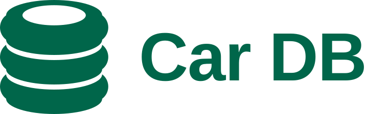

<picture>
  <source media="(prefers-color-scheme: dark)" srcset="cardb-lockup-horizontal-white.svg">
  
</picture>

# Car DB logo

**Idea.** Three tyres stacked and seen slightly from above, with the rim hole in the top one,
so the stack is also the database cylinder: Car + DB in one shape.

## Files

All masters are SVG with filled outlines (no strokes, no live text). Each comes in `green`
(sign green on paper), `white` (reversed, for the green masthead and dark grounds) and `black`.

| File                                                           | Use                                                                                           |
| -------------------------------------------------------------- | --------------------------------------------------------------------------------------------- |
| `cardb-symbol-*.svg`                                           | The mark on its 256 × 256 construction canvas. 24 px tall ink and up.                         |
| `cardb-symbol-small-*.svg`                                     | Small cut for 16–32 px only (favicons, tab icons).                                            |
| `cardb-lockup-horizontal-*.svg`                                | Mark + name. The default lockup.                                                              |
| `cardb-lockup-stacked-*.svg`                                   | Mark over name, for square-ish spaces.                                                        |
| `cardb-tile-green.svg`, `cardb-tile-green-dark.svg`            | App icon: white mark on a rounded tile, light- and dark-scheme green. Also `assets/icon.svg`. |
| `cardb-tile-small-green.svg`                                   | The tile with the small cut; it is the site's `favicon.svg`.                                  |
| `cardb-tile-square-green.svg`, `cardb-tile-maskable-green.svg` | Full-bleed sources of `apple-touch-icon.png` and `icon-maskable-*.png`.                       |

The site's raster icons in `apps/web/public/` are rendered from these tiles with
`rsvg-convert -w <size> -h <size> -o <png> <tile>`:

| Icon                                             | Tile                            | Sizes          |
| ------------------------------------------------ | ------------------------------- | -------------- |
| `favicon.ico`                                    | `cardb-tile-small-green.svg`    | 16, 32         |
| `favicon.ico`                                    | `cardb-tile-green.svg`          | 48             |
| `favicon.svg`                                    | `cardb-tile-small-green.svg`    | copied as is   |
| `apple-touch-icon.png`                           | `cardb-tile-square-green.svg`   | 180, alpha off |
| `icon-192.png`, `icon-512.png`                   | `cardb-tile-green.svg`          | 192, 512       |
| `icon-maskable-192.png`, `icon-maskable-512.png` | `cardb-tile-maskable-green.svg` | 192, 512       |

The ICO holds the three renders as PNG entries (32-bit, in size order). iOS fills transparency
with black, so the apple-touch PNG is written without alpha
(`magick <png> -alpha off PNG24:apple-touch-icon.png`).

## Construction

- **Main mark**, 256 grid: three tyres, each an ellipse face of rx 94, ry 30 over a side 48
  tall, with gaps of 10 between them. The sidewalls bulge 12 as circular arcs (radius 30).
  The top tyre's rim hole is an ellipse of rx 62 (ry 19.79, the face's proportion). The ink
  box is 212 × 224 (x 22–234, y 14–238).
- **Reversed** (`white`, and every tile): gaps 12 and sides 46.67, so the height stays 224,
  and a rim hole of rx 64. Light ink on green looks heavier than green ink on paper; this
  takes the weight back out.
- **Small cut**, for 16–32 px: rx 92, ry 28, bulge 18, sides 50, gaps 22, rim hole 58; the
  reversed small cut has gaps 24 and sides 48.67. Wider gaps and a deeper bulge keep the
  three tyres apart at favicon size.
- **Wordmark**: "Car DB" in Liberation Sans Bold (SIL OFL; metric twin of Arial, the site's
  face), outlined, tracked −0.01 em, cap height 92 against the 224-unit mark. Horizontal
  lockup: gap 60, the caps centred on the mark. Stacked lockup: gap 52, the name centred
  under the mark.
- **Tiles**: the reversed mark at 0.66 scale on a 256 tile with corner radius 48, in sign
  green or dark-scheme green. The square tile is the same full bleed; the maskable tile is
  full bleed at 0.52, inside the maskable safe zone. The small tile carries the reversed
  small cut at 0.84.
- **Masthead**: live text, with the reversed mark inline before it in `currentColor`, cropped
  to its ink and 24 px tall at every width (`.wordmark` in `apps/web/src/styles/base.css`).
  The gap and the centring follow the horizontal lockup. Below 30rem the mark stands alone
  and the name becomes visually hidden link text.

## Clear space and minimum size

Keep clear space of one tyre height (48 units on the 256 grid) on every side.

| Version           | Smallest                                                      |
| ----------------- | ------------------------------------------------------------- |
| Symbol            | 24 px tall ink (a 28 px canvas); below that use the small cut |
| Small cut         | 16 px; use it only from 16 to 32 px                           |
| Horizontal lockup | 120 px wide                                                   |
| Stacked lockup    | 64 px wide                                                    |

## Colour

| Name                    | HEX       | RGB         | On                                                                     |
| ----------------------- | --------- | ----------- | ---------------------------------------------------------------------- |
| Sign green              | `#00664a` | 0 102 74    | Mark on white paper; tile and masthead ground (white on it is 7.0 : 1) |
| Sign green, dark scheme | `#0c5240` | 12 82 64    | Tile and masthead ground in dark mode (white on it is 9.1 : 1)         |
| White                   | `#ffffff` | 255 255 255 | Mark on either green or on dark paper                                  |
| Black                   | `#000000` | 0 0 0       | One-colour print, fax, stamps                                          |

Approved pairs: green on white · white on sign green · white on dark-scheme green · white on
dark paper · black on white. Not green on dark paper (2.4 : 1). White ink always uses the
reversed masters.

## Don't

Stretch, rotate or slant the mark · add or remove tyres · fill the rim hole or close the gaps
between tyres · draw the sides straight · use the main mark's green geometry in white, or the
reversed geometry in green · use the small cut above 32 px or the main mark below 24 px ·
retype the wordmark in another face or move the parts of a lockup · add outlines, shadows or
gradients · put it on a busy background without the tile.
