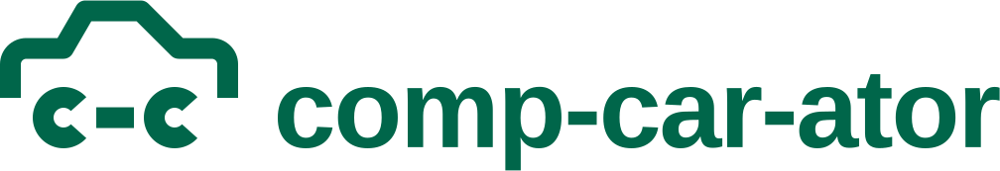

<picture>
  <source media="(prefers-color-scheme: dark)" srcset="cc-lockup-horizontal-white.svg">
  
</picture>

# comp-car-ator logo

**Idea.** A car drawn as one line whose wheels are two lowercase c's with a hyphen between
them, so the car spells "c-c": the hyphens of comp-car-ator, its initials, and engine cc.

## Files

All masters are SVG with filled outlines (no strokes, no live text). Each comes in `green`
(sign green on paper), `white` (reversed, for the green masthead and dark grounds) and `black`.

| File                                                     | Use                                                                                           |
| -------------------------------------------------------- | --------------------------------------------------------------------------------------------- |
| `cc-symbol-*.svg`                                        | The mark on its 256 × 256 construction canvas. Everything above 24 px.                        |
| `cc-symbol-small-*.svg`                                  | Small cut for 16–32 px only (favicons, tab icons).                                            |
| `cc-lockup-horizontal-*.svg`                             | Mark + name. The default lockup.                                                              |
| `cc-lockup-stacked-*.svg`                                | Mark over name, for square-ish spaces.                                                        |
| `cc-tile-green.svg`, `cc-tile-green-dark.svg`            | App icon: white mark on a rounded tile, light- and dark-scheme green. Also `assets/icon.svg`. |
| `cc-tile-small-green.svg`                                | The tile with the small cut; it is the site's `favicon.svg`.                                  |
| `cc-tile-square-green.svg`, `cc-tile-maskable-green.svg` | Full-bleed sources of `apple-touch-icon.png` and `icon-maskable-512.png`.                     |

The site's raster icons (`apps/web/public/`: `favicon.ico` 16/32 small cut + 48 main,
`apple-touch-icon.png`, `icon-192.png`, `icon-512.png`, `icon-maskable-512.png`) are
rendered from these tiles with `rsvg-convert`; the ICO stores PNGs.

## Construction

- **Main mark**, 256 grid: one stroke weight, 21. The body line has 16-radius shoulders and
  round joins; rear pillar at 60°, windscreen at 45°. Wheels are rings (outer radius 31,
  inner 10) opened by radial cuts at ±42°. The hyphen (38 × 21) sits on the wheel axis, 10
  from each wheel. The ink box is 240 × 150, centred on the canvas.
- **Small cut**, 32-unit grid × 8: weight 16, mitred corners, square cabin, apertures cut at
  ±45°. Every horizontal and vertical edge falls on a whole pixel at both 16 and 32 px.
- **Wordmark**: "comp-car-ator" in Liberation Sans Bold (SIL OFL; metric twin of Arial, the
  site's face), outlined, tracked −0.02 em. In the lockups its c's are exactly as tall as the
  c-wheels and stand on the same line, so the word's hyphens fall on the mark's hyphen axis.
  Gap between mark and word: 40 units (about half the cap height).
- **Masthead**: live text, with the mark inline before it, 1.75em wide, its bottom on the
  text baseline (`.wordmark` in `apps/web/src/styles/base.css`). That is a little smaller
  than the lockup ratio, as approved on the mock-up: about 26 × 16 px next to 15 px text.
  Below 30rem the mark stands alone and the name becomes visually hidden link text.

## Clear space and minimum size

Keep clear space of one wheel diameter (the height of the wordmark's "c") on every side.

| Version           | Smallest                                                    |
| ----------------- | ----------------------------------------------------------- |
| Symbol            | 24 px wide ink (26 px canvas); below that use the small cut |
| Small cut         | 16 px; draw it only at 16 and 32 px                         |
| Horizontal lockup | 120 px wide                                                 |
| Stacked lockup    | 64 px wide                                                  |

## Colour

| Name                    | HEX       | RGB         | On                                                                     |
| ----------------------- | --------- | ----------- | ---------------------------------------------------------------------- |
| Sign green              | `#00664a` | 0 102 74    | Mark on white paper; tile and masthead ground (white on it is 7.0 : 1) |
| Sign green, dark scheme | `#0c5240` | 12 82 64    | Tile and masthead ground in dark mode (white on it is 9.1 : 1)         |
| White                   | `#ffffff` | 255 255 255 | Mark on either green or on dark paper                                  |
| Black                   | `#000000` | 0 0 0       | One-colour print, fax, stamps                                          |

Approved pairs: green on white · white on sign green · white on dark-scheme green · white on
dark paper · black on white. Not green on dark paper (2.4 : 1).

## Don't

Stretch, rotate or slant the mark · redraw the c's as other letters or round wheels · close
the c apertures · drop or move the hyphen · use the small cut above 48 px or the main mark
below 24 px · change the stroke weight · retype the wordmark in another face or move the
parts of a lockup · add outlines, shadows or gradients · put it on a busy background without
the tile.
